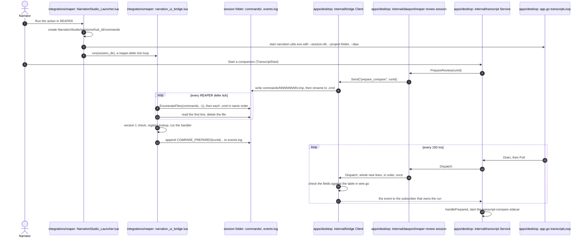

# The REAPER bridge and its test harness

**Status: implemented.** The Lua under `integrations/reaper` is tested without REAPER by a harness; what only a running REAPER can show is checked in scripted REAPER runs (the line identity checklist and the bridge commands passed 37 checks in REAPER 7.80; the fake is pinned to what that run observed). Decisions: [The DAW port](daw-integration.md#the-daw-port) (a Lua file bridge, no loopback server) and [The DAW port](daw-integration.md#the-daw-port) (the harness). The boundary rules for what lives in Lua are in [DAW integration](daw-integration.md).

## What is in `integrations/reaper`

| File | Role |
| --- | --- |
| `NarrationStudio_Launcher.lua` | The one REAPER action. Finds the app executable, starts it with the session directory, project and DAW arguments, then runs the bridge loop. Its name and path are stable: the narrator imports it into REAPER's action list. |
| `NarrationUtils_Launcher.lua` | Deprecated shim that runs `NarrationStudio_Launcher.lua`, so an action loaded under the old name keeps working. Removed when the old name is retired. |
| `narration_ui_bridge.lua` | The command loop and the registry it dispatches through: polls `commands/` from a `reaper.defer` loop, looks each command up, appends results to `events.log`. Lists the feature files in `FEATURE_FILES` and loads them next to itself. |
| `narration_bridge_core.lua` | Shared by the bridge and every feature file: the percent-encoding and field-splitting helpers, `event`, file and path helpers, and `new_registry()`. |
| `narration_cleanup.lua`, `narration_compare.lua`, `narration_line_identity.lua`, `narration_pickups.lua`, `narration_render.lua`, `narration_project_state.lua`, `narration_retake_lanes.lua`, `narration_take_review.lua`, `narration_navigation.lua`, `narration_track_state.lua`, `narration_track_select.lua`, `narration_transport.lua`, `narration_workspace.lua`, `narration_regions.lua`, `narration_level_normalize.lua`, `narration_punch.lua`, `narration_master_render.lua`, `narration_takes.lua`, `narration_roll.lua`, `narration_range.lua`, `narration_media_file.lua` | The commands, one file per feature (the cleanup launchers; the cleanup preview markers and approved trims; the level-match gain; punch-to; the mastering chain read and FX render; Transcript Compare; manuscript line identity; the pickup list; per-chapter render configuration; the live project-change indicator; the retake-lane pick; take creation; going to and looping a finding, and adding its approved marker; the live transport and track state; selecting a chapter's track; arming and recording; the workspace's take and FX actions; chapter and credits regions; hiding other takes; rolling again while recording; cutting words and their audio; playing and showing a file on disk). |
| `reaper_common_core.lua`, `reaper_common_process.lua` | Small helpers the launcher loads: files and paths, hidden process launch, pipe splitting. |
| `tests/` | The harness (below). Not shipped: `scripts/release/prepare-resources.py` leaves `tests/`, `spikes/` and `project.json` out of the app's embedded REAPER package. |
| `spikes/` | Scripts that run inside a real REAPER, isolated in a temp resource directory, to find out what a fake cannot ([README](../../integrations/reaper/spikes/README.md); the S0 result is [reaper-spike-s0-item-extension-data.md](../research/reaper-spike-s0-item-extension-data.md)). Research tools, not product code. |

## The file protocol

The Go host (`apps/desktop/internal/bridge`) and the Lua bridge share one session directory, `<REAPER resource path>/NarrationStudio/sessions/hub_<id>/`, created by the launcher.

- **Commands** go one way. `Client.Send` writes `commands/NNNNNNNN.cmd` atomically (a `.tmp` file, then a rename) holding one line of percent-encoded, `|`-separated fields: protocol version `1`, the command name, then its arguments. The bridge reads the first line of each `.cmd` file in name order, deletes it, and dispatches. It splits at most eight fields; a payload that needs more travels as a file whose path is an argument.
- **Events** come back through the append-only `events.log`, one percent-encoded, `|`-separated line per event with the tag first. **The first argument of every event is the run ID of the command that caused it** (the command's own first argument), so a consumer can tell its events from another's. On Windows Lua writes CRLF in text mode, so a reader trims a trailing carriage return (the Go client does).
- **Errors** are `ERROR|<run_id>|<message>` events. When a command `bridge.Actions` sent fails (a send error, no answer in time, an `ERROR`, a cancel), the host writes one `reaper_action_failed` line to its host log ([Wire contracts: how data is checked where it crosses a boundary](wire-contracts.md)) with the command, its run ID and the failure's kind, so it can be matched with `events.log`; the script's sentence is not copied there, since it can hold a track's or a file's name. The run ID is the failing command's first argument, or empty when there is none: an unsupported protocol version is `ERROR||Unsupported hub protocol`, an unknown command is `ERROR|<its first argument>|Unsupported workspace command`. An empty run ID marks a session-level problem, delivered to every consumer that handles errors.

The bridge polls the commands folder with `reaper.EnumerateFiles`, which **caches a directory's listing** (REAPER 7.80: a file created after the first call stays invisible and a removed one stays listed, for seconds, until the listing is cleared with index `-1`). Every listing therefore starts with `EnumerateFiles(dir, -1)`, and a listed file that cannot be opened is skipped without an event. Without the clear, a consumed command stays listed and is reported as `ERROR|Unsupported hub protocol`, and a new command can wait for the cache to expire; both show only in a real REAPER (found by the scripted run recorded in [docs/research](../research/)), and the harness's fake caches the listing the same way.

Every command that writes to the project is one undo block, writes nothing when there is nothing to change, and is safe to send twice.

Two commands, `launch_cleanup_tool` and `pick_retake_lane`, additionally carry the host's `runlog` run id and debug level (`internal/runlog`) as two trailing fields, after their own — a different id than the per-request one every command's first argument already is. When the level is `debug` and a run id is present, Lua writes one JSON line per command received and one per its result or refusal to `bridge.jsonl` in the session folder (`core.debug_log`): ids, counts and a fixed refusal-reason key only. It is a no-op otherwise, so an ordinary session never creates the file. Other commands do not write it.

### One command, step by step

Starting the bridge, and one Transcript Compare command travelling through it and back.



*Verified 2026-09-21 against `NarrationStudio_Launcher.lua`, `narration_ui_bridge.lua` (`M.run`, the `tick` loop), `narration_bridge_core.lua`, `apps/desktop/internal/bridge/{bridge,events,wire}.go`, `apps/desktop/internal/dawport/reaper/review.go`, `apps/desktop/internal/transcript/service.go` (`Start`, `Drain`, `Handle`) and `apps/desktop/app.go` (`transcriptLoop`, `pollTranscript`), and by the harness, which drives the same protocol ([The DAW port](daw-integration.md#the-daw-port)). The command names here are generic on purpose: every command travels this way, so the diagram does not change when one is added ([The DAW port](daw-integration.md#the-daw-port)). The threats at steps 6 to 11 are rows 5a to 5c of the [threat model](threat-model.md#5-the-reaper-file-bridge-not-in-securitymd-see-the-note-under-the-table).*

## Reading events in the host: the fan-out

`bridge.Client` (`apps/desktop/internal/bridge/events.go`) is the one reader of `events.log` and feeds every consumer, so two features can use one session without stealing each other's events.

```go
client.Subscribe(bridge.Subscription{
	Tags:   []string{"COMPARE_*", "ERROR"}, // exact tags, or a prefix ending in "*"
	Owns:   func(runID string) bool { ... }, // does this consumer track that run?
	Handle: func(event bridge.Event) { ... }, // event.Tag, event.RunID, event.Fields (tag first)
})
```

- **Routing.** An event goes to each consumer whose `Tags` match it and, when it carries a run ID, whose `Owns` is nil or true for that run. An event with an empty run ID goes to every consumer whose tags match. An event nobody accepts (an unowned run, an unwanted tag) is dropped and counted (`Undelivered()`); a line that does not decode is skipped and counted (`Malformed()`).
- **Delivery.** `Dispatch()` reads the lines appended since the last call and delivers them in log order, once, on the calling goroutine, serialised across callers; the host's 150 ms loop already calls it through `transcript.Service.Drain`, so a second consumer only subscribes. Only whole lines are consumed: a line REAPER is still writing waits for the next call.
- **Consumers today:** `bridge.Actions` (`actions.go`) subscribes to the answers of the track, record, take, FX and region commands (`TRACK_*`, `ARMED`, `RECORD_*`, `ACTIVE_TAKE_SET`, `TAKES_HIDDEN`, `ITEM_STALE`, `FX_CHAIN*`, `REGIONS_CREATED`, `ERROR`) for the requests it has in flight; the Transcript Compare service subscribes to `COMPARE_*`/`ERROR`, `apps/desktop/internal/lineidentity` to `LINES_*`/`ERROR`, `apps/desktop/internal/pickups` to the pickup tags (`PICKUPS_IMPORTED`, `PICKUPS_EXPORTED`, `PICKUPS_COUNTED`, `PICKUP_NEXT`, `PICKUP_RESOLVED`, `PICKUP_REOPENED`, `PICKUP_MARKERS_LISTED`) and `ERROR`, `apps/desktop/internal/renderconfig` to `RENDER_CONFIGURED`/`ERROR`, `apps/desktop/internal/cleanuptools` to `CLEANUP_LAUNCHED`/`ERROR`, and `apps/desktop/internal/retakelanes` to `RETAKE_LANE_PICKED`/`ERROR`, each for its own run; `bridge.Navigator` subscribes to the navigation answers (`NAVIGATED`, `LOOP_STARTED`, `LOOP_STOPPED`, `PONG`, `FINDING_MARKER`, `FINDING_STALE`, `ERROR`) of the requests it has in flight ([going to and looping a finding](reaper-navigation.md); `configureLocked` constructs it on the same client for the Review page's bindings).

### Checking events before they are delivered

`Client.Dispatch` checks each decoded line against a table (`apps/desktop/internal/bridge/wire.go`, [wire contracts](wire-contracts.md#reaper-events-appsdesktopinternalbridgewirego)): the fields after the tag, which are required, which are numbers. The Lua script is imported into REAPER by the narrator and can be older or newer than the app, so a line that is too short or whose number is not a number is **not delivered**: it is counted (`Invalid()`), logged (`reaper_event_invalid`) and handed to the consumers of its tag and run through `Subscription.Invalid`. Transcript Compare ends its run with a message naming the event and field. A tag that is not in the table passes through (a newer script's event), and the optional tail of `COMPARE_MARKER` may be absent (an older script). **Adding an event to a feature file means adding it to the table**, and `wire_test.go` fails when a tag is in one and not the other; it uses the same lines the harness pins.

## Reachability heartbeat

`narration_ui_bridge.lua`'s tick loop also appends a `PROJECT_STATUS` event every `HEARTBEAT_INTERVAL_SECONDS` (1.5s), independent of any command: `PROJECT_STATUS||<rpp>|<unsaved>|<changeCount>|<playState>|<playPosition>`, with an empty run ID and `<rpp>` exactly what `EnumProjects(-1, '')` returns (the empty string, never `nil`, for an unsaved project - confirmed on a real REAPER 7.80, [spike S6](../research/reaper-spike-s6-daw-reachability.md)). `<changeCount>` is `GetProjectStateChangeCount(0)`, REAPER's edit counter, appended so the host can tell the project changed before it is saved; it is optional in `wire.go` (an older script sends three fields) and empty on a REAPER without the call. `<playState>` (`GetPlayState()`: 1 playing, 2 paused, 4 recording) and `<playPosition>` (`GetPlayPosition()`, seconds) are the transport, appended after it and optional for the same reason; the tick loop also sends a heartbeat at once when `<playState>` changes, so a record start is not held back by the interval. The empty run ID is deliberate: `events.go`'s fan-out already delivers a run-less event to every subscriber regardless of `Owns` ("Routing" above), so this is a broadcast with no new delivery mechanism. `apps/desktop/internal/daw.Reachability` subscribes to it on the same `bridge.Client` `transcript.Service` uses (`configureLocked`), tracks the freshness of the last heartbeat (5s timeout) and exposes `Reachable()`, `Matches(linkedPath)` (case-insensitive, path-normalized), `ChangeCount()` and `Transport()` (the DAW port's `Heartbeat` role; the host pushes it to the UI as `daw_transport_changed`, `bindings_daw_transport.go`); chapter sync's watcher (`apps/desktop/chaptersync_watch.go`, [chaptersync_watch.go](../../apps/desktop/chaptersync_watch.go)) reads `ChangeCount()` only while `Matches` names the watched `.rpp`, to say REAPER has unsaved edits, and sends nothing; `dawfacts.go`'s `dawLinkFacts` uses `Reachable()` and `Matches` to compute Bootstrap's `dawReachable`/`dawProjectMatches` facts ([locate.go](../../apps/desktop/internal/daw/locate.go)). The Lua harness's `Session:events()` filters `PROJECT_STATUS` out for every other test file's sake (it would otherwise be a stray trailing event in every exact event-list assertion); `Session:all_events()` includes it, used only by `reachability_test.lua`.

## The command registry

A command is a handler `function(ctx, args)` registered under its name. `ctx.session_dir` is the session directory, `ctx.event(tag, ...)` appends an event, `ctx.stop()` ends the loop (the `close` command is just that). `args` are the command's fields after its name, already percent-decoded. A name may be registered once: registering it twice is an error, so two features cannot shadow each other. An unknown name is answered with `ERROR|Unsupported workspace command`, an unsupported protocol version with `ERROR|Unsupported hub protocol`.

To add a command:

1. Write the harness tests first (see below), and watch them fail.
2. Put the command in `integrations/reaper/narration_<feature>.lua`. The file starts with `local core = ...` (the shared helpers arrive as the chunk argument) and returns `function(registry)`, which creates the feature's state (a `runs` table, say) and calls `registry.register(name, handler)`.
3. List the file in `FEATURE_FILES` in `narration_ui_bridge.lua`, in `scripts/release/reaper-files.mjs` and in `smokeReaperFiles` in `apps/desktop/smoke.go` (the installer check requires every file listed there, and `smoke_test.go` holds the two lists to the folder; `reaper-files.test.mjs` fails when the list and the folder disagree, and a registry test fails when a feature file exists that the bridge does not load).
4. Add the command to the table below and to the registry test that pins the list of registered names.

The feature files are `loadfile`d when the bridge module loads, so a missing or broken one fails the launcher's `dofile` and the narrator sees "Could not load Narration Utils shared libraries" before the app starts. The bridge finds its own folder from `debug.getinfo` and falls back to the running action's path.

## Commands

| Command | Arguments after the name | Events |
| --- | --- | --- |
| `prepare_compare` | `run_id`, optional `project_folder` (the app's project folder; the manuscript is read and the diffs written there instead of beside the `.rpp`) | `COMPARE_PREPARED\|run\|manifest\|manuscript\|track\|diff\|items[\|changeCount]` (REAPER's edit counter as the audio was listed, the baseline for "changed since comparison"; absent without `GetProjectStateChangeCount`), or `ERROR` |
| `inspect_compare_results` | `run_id`, `results_path` | `COMPARE_MARKER\|...` per row, then `COMPARE_INSPECTED\|run\|summary\|total\|already-marked` |
| `export_compare_markers` | `run_id`, `results_path`, three `RRGGBB` colours | `COMPARE_EXPORT_MARKER\|run\|row\|state\|existing-name` per row, then `COMPARE_EXPORTED\|run\|added\|skipped` |
| `jump_to_compare_marker` | `run_id`, `row_id` | none, or `ERROR` |
| `stamp_item_lines`, `read_line_ids` | see [manuscript line identity](manuscript-line-identity.md) | `LINES_*` |
| `create_regions` | `run_id`, `payload_path` (`start\|end\|title` rows), `RRGGBB` or empty, `update` (`1` or `0`) | `REGIONS_CREATED\|run\|created\|existing\|invalid\|updated\|ambiguous\|failed`, or `ERROR`. Experimental |
| `import_pickups` | `run_id`, `payload_path` (`start\|tag\|note` rows) | `PICKUPS_IMPORTED\|run\|added\|already-there\|invalid`, or `ERROR` |
| `export_pickups` | `run_id`, `output_path` | `PICKUPS_EXPORTED\|run\|path\|count`, or `ERROR` |
| `next_pickup` | `run_id` | `PICKUP_NEXT\|run\|pos\|tag\|note`, or `ERROR` when none remain |
| `resolve_pickup` | `run_id`, `position` | `PICKUP_RESOLVED\|run\|pos\|tag\|note`, or `ERROR` |
| `reopen_pickup` | `run_id`, `position` | `PICKUP_REOPENED\|run\|pos\|tag\|note`, or `ERROR` when no resolved pickup is within the tolerance |
| `list_pickup_markers` | `run_id`, `output_path` | `PICKUP_MARKERS_LISTED\|run\|path\|open\|done` (file rows `start\|state\|tag\|note`, state `open` or `done`; read-only), or `ERROR` |
| `count_pickups` | `run_id` | `PICKUPS_COUNTED\|run\|remaining\|total` |
| `configure_chapter_render` | `run_id`, `output_folder` | `RENDER_CONFIGURED\|run\|folder\|count\|targets`, or `ERROR` |
| `master_chain_read` | `run_id` | a `MASTER_CHAIN_FX\|run\|track\|trackName\|name\|enabled` per FX slot (every track's, then the master's as track `master`; at most 500), then `MASTER_CHAIN_READ\|run\|count\|truncated`, or `ERROR`. Reads only. Experimental |
| `render_with_fx` | `run_id`, `approval` (a one-time hex token), `folder` (an empty `<project>/narration-utils/mastering/<name>`), `regions` (one per line) | a `FX_RENDER_FILE\|run\|region\|path` per region, then `FX_RENDERED\|run\|folder\|count`, or `ERROR`. The bridge's only render (below). Experimental |
| `project_state` | `run_id` | `PROJECT_STATE\|run\|change_count\|project_path`, or `ERROR` |
| `play_position` | `run_id` | `PLAY_POSITION\|run\|state\|heard\|processed\|cursor` (read-only; `GetPlayPosition`, `GetPlayPosition2`, the edit cursor), or `ERROR` |
| `punch_to` | `run_id`, `time`, `preroll` | `PUNCHED\|run\|cursor` (the edit cursor at `max(0, time − preroll)`; no undo block, refused while recording), or `ERROR` |
| `roll` | `run_id`, `track_guid`, `at` | `ROLLED\|run\|track\|at\|undoPoints` once REAPER records again from `at` (undoPoints is 0), `RECORD_NOT_OURS`, `TRACK_STALE`, or `ERROR`. Only while the recording `record_start` began runs on that track; refused unless REAPER's overlapping-recording option keeps the earlier audio as a take. Experimental (below) |
| `delete_range` | `run_id`, `item_guid`, `start`, `end` (project seconds), `mode` (`close` or `gap`), `fade_ms` (0 to 500) | `RANGE_CUT\|run\|leftItemGuid\|cutItemGuid\|undoPoints` (leftItemGuid empty when the cut starts at the item's start; undoPoints is 1), `ITEM_STALE\|run\|guid\|item`, or `ERROR`. Moves the middle piece to the muted Cuts track and deletes nothing; one undo block; refused while recording. Experimental (below) |
| `apply_fx_range` | `run_id`, `item_guid`, `start`, `end` (project seconds), `chain` (as `list_fx_chains` lists it), `fade_ms` (0 to 500) | `RANGE_FX_APPLIED\|run\|itemGuid\|takeGuid\|chain\|undoPoints` (the piece the chain went on and its take; undoPoints is 1), `ITEM_STALE\|run\|guid\|item`, or `ERROR`. Splits the item at both ends and loads the chain onto the middle piece's take; one undo block; refused while recording. Experimental (below) |
| `remove_fx_range` | `run_id`, `item_guid` (the piece `apply_fx_range` answered), `chain` | `RANGE_FX_REMOVED\|run\|itemGuid\|chain\|undoPoints` (the item the piece is part of afterwards; undoPoints 1, or 0 when the piece no longer carries the chain), `ITEM_STALE\|run\|guid\|item`, or `ERROR`. Takes off the FX the chain added and joins the piece to the neighbours that carry on its audio; one undo block; refused while recording. Experimental (below) |
| `fx_range_params` | `run_id`, `item_guid` (the piece `apply_fx_range` answered), `take_guid` (its take, or empty for the piece's take that carries the chain), `chain` | One `RANGE_FX_PARAM\|run\|fx\|fxName\|param\|name\|value\|min\|max\|step\|formatted` per setting of the chain's FX (at most 512), then `RANGE_FX_PARAMS\|run\|itemGuid\|takeGuid\|chain\|count\|truncated\|bypassed`; `ITEM_STALE\|run\|guid\|item, take or fx`, or `ERROR`. Reads only; no undo block. Experimental |
| `fx_range_set_param` | as `fx_range_params`, then `fx` (the FX's place in the chain), and `param\|value` in the last field | `RANGE_FX_PARAM_SET\|run\|itemGuid\|takeGuid\|fx\|param\|value\|formatted\|undoPoints` (the value REAPER holds afterwards; undoPoints 1, or 0 when the setting already had it), `ITEM_STALE`, or `ERROR`. One undo block; refused while recording. Experimental |
| `fx_range_bypass` | as `fx_range_params`, then `1` (bypass) or `0` (turn back on) | `RANGE_FX_BYPASSED\|run\|itemGuid\|takeGuid\|chain\|bypassed\|undoPoints` (undoPoints 1, or 0 when every FX of the chain already was), `ITEM_STALE`, or `ERROR`. One undo block; refused while recording. Experimental |
| `fx_range_compare` | as `fx_range_params` | `RANGE_FX_COMPARE\|run\|itemGuid\|takeGuid\|chain\|start\|end\|bypassed` (the piece's project seconds, and bypassed 1 when the chain was bypassed before), at once, `ITEM_STALE`, or `ERROR`. Plays the piece with the chain on, then bypassed, and puts it back; no undo block; refused while recording. Experimental |
| `stop_fx_compare` | `run_id` | `RANGE_FX_COMPARE_STOPPED\|run\|stopped` (1 when a Compare was running). Experimental |
| `reduce_range_gain` | `run_id`, `item_guid`, `take_guid`, `reduce_db` (1 to 24), `stretches` (`start:end` pairs in the take's source seconds, comma-separated, at most 500) | `RANGE_GAIN_REDUCED\|run\|itemGuid\|takeGuid\|stretches\|reduceDb\|undoPoints` (`stretches` counts those whose ramps met as one; undoPoints is 1), `ITEM_STALE\|run\|guid\|item or take` (a stretch the item no longer plays answers `item`), or `ERROR`. Points on the take's volume envelope; the audio is untouched; one undo block; refused while recording. Experimental |
| `repair_click` | `run_id`, `item_guid`, `take_guid`, `clicks` (`start:end` pairs in the take's source seconds, comma-separated, at most 500, each at most 50 ms) | `CLICKS_REPAIRED\|run\|itemGuid\|takeGuid\|clicks\|undoPoints` (`clicks` counts those whose ramps met as one; undoPoints is 1), `ITEM_STALE\|run\|guid\|item or take` (a click the item no longer plays answers `item`), or `ERROR`. A short dip on the take's volume envelope; the audio is untouched; one undo block; refused while recording. Experimental |
| `last_action` | `run_id`, `kind` (`cut_range`, a name in a fixed table in `narration_bridge_core.lua`; any other value, a label included, is refused) | `LAST_ACTION\|run\|kind\|this` when REAPER's next undo point is exactly the kind's label, else `...\|other`; or `ERROR`. Reads `Undo_CanUndo2(0)` and changes nothing; works while recording. Experimental |
| `undo_last` | `run_id`, `kind` (as above), `steps` (1 to 12) | `UNDONE_LAST\|run\|kind\|steps\|undone`, or `ERROR`. Undoes up to `steps` points from the top, reading the top label again before each and stopping at the first that is not exactly the kind's, so it never undoes a point the narrator or another command made. Opens no undo block; refused while recording. Experimental |
| `monitor_level` | `run_id`, `level` (empty to read, or a whole number from 0 to 100 in plain digits to set) | `MONITOR_LEVEL\|run\|level`, the level now held (0 to 100, read back after a set), or `ERROR` (no hardware output on the master, a level that is not a whole number from 0 to 100, or REAPER did not accept the set). The level is the volume of the master track's first hardware output send, not a fader, mapped in the script: 70 is 0 dB, 100 is +6 dB, 0 is silence. Opens no undo block; works while recording. Experimental |
| `launch_cleanup_tool` | `run_id`, `tool` (`repair_pops_clicks` or `magnolius_declick`, nothing else) | `CLEANUP_LAUNCHED\|run\|tool\|action-name`, or `ERROR` |
| `apply_item_gain` | `run_id`, `payload_path` (level-match candidates) | a `GAIN_ITEM\|run\|guid\|before\|after` per item, then `GAIN_APPLIED\|run\|applied`, `GAIN_STALE`, or `ERROR`. Multiplies the item's own volume; one undo block per call; refused while recording |
| `pick_retake_lane` | `run_id`, `line_id`, `item_guid` | `RETAKE_LANE_PICKED\|run\|line-id\|item-guid\|lane` (0-based), or `ERROR` |
| `create_take` | `run_id`, `payload_path` (one row: `target_item_guid\|candidate_item_guid\|source_start\|source_end\|finding_id\|source_file`) | `TAKE_CREATED\|run\|target-item-guid\|new-take-guid`, `TAKE_STALE\|run\|guid`, or `ERROR` |
| `navigate_item`, `loop_context`, `stop_loop`, `ping` | see [going to and looping a finding](reaper-navigation.md) | `NAVIGATED`, `LOOP_STARTED`, `LOOP_STOPPED`, `PONG`, `FINDING_STALE`, or `ERROR` |
| `add_finding_marker` | see [adding the approved marker](reaper-navigation.md#adding-the-approved-marker) | `FINDING_MARKER`, `FINDING_STALE`, or `ERROR` |
| `chapter_track_state` | `run_id`, `track_guid` (empty for the transport only) | `TRACK_STATE\|run\|guid\|playState\|editCursor\|playPosition\|rpp\|unsaved\|changeCount\|thisArmed\|armedCount\|recInput\|inputDevice`, a `TRACK_ITEM\|run\|itemGuid\|takeGuid\|position\|length\|sourceOffset\|playrate\|sourceFile\|muted` per item (at most 1000; `muted` appended by `docs/architecture/manuscript-teleprompter.md#resume-where-reaper-is-and-where-the-prompter-was`, optional), then `TRACK_STATE_END\|run\|listed\|total`; `TRACK_STALE\|run\|guid` when the track is gone, or `ERROR`. Experimental (below) |
| `select_track` | `run_id`, `track_guid` | `TRACK_SELECTED\|run\|guid`, or `TRACK_STALE\|run\|guid` when the track is gone. Experimental |
| `arm_only` | `run_id`, `track_guid` | `ARMED\|run\|guid\|disarmed\|changed`, `TRACK_STALE`, or `ERROR`. Experimental |
| `record_start` | `run_id`, `track_guid` (the one armed track), optional `end` | `RECORD_STARTED\|run\|guid\|position` once REAPER reports recording, `TRACK_STALE`, or `ERROR` (a refusal, or REAPER did not start); later `RECORD_ENDED\|run\|restored\|kept` if the narrator stops it in REAPER. Experimental |
| `record_stop` | `run_id` | `RECORD_STOPPED\|run\|restored\|kept`, or `RECORD_NOT_OURS\|run` when no recording this bridge started is running. Experimental |
| `set_active_take` | `run_id`, `item_guid`, `take_guid` | `ACTIVE_TAKE_SET\|run\|itemGuid\|takeGuid\|changed`, `ITEM_STALE\|run\|guid\|reason`, or `ERROR`. Experimental |
| `hide_takes` | `run_id`, `item_guid`, `keep_take_guid` | `TAKES_HIDDEN\|run\|itemGuid\|count\|changed` (`count` takes hidden; `changed` 1 when it added an undo point), `ITEM_STALE\|run\|guid\|reason`, or `ERROR`. Experimental |
| `stack_takes`, `unstack_takes` | `run_id`, `payload_path` (see [Stacking takes](#stacking-takes-narration_takeslua)) | `TAKES_STACKED\|run\|groups\|takes\|shift\|undoPoints` or `TAKES_UNSTACKED\|run\|groups\|takes\|shift\|undoPoints` (`shift` the seconds the audio after moved, negative for a stack; undoPoints is 1), `ITEM_STALE\|run\|guid\|item or take`, or `ERROR`. Experimental |
| `split_take` | `run_id`, `item_guid`, `take_guid`, `at` (seconds into the project) | `TAKE_SPLIT\|run\|itemGuid\|takeGuid\|newTakeGuid\|at\|undoPoints` (the item ends at the cut and the new take plays the second read on the first read's spot; undoPoints is 1), `ITEM_STALE\|run\|guid\|item or take` (a cut not inside the item answers `item`), or `ERROR`. Experimental |
| `list_fx_chains` | `run_id` | `FX_CHAIN\|run\|name` per chain, then `FX_CHAINS_LISTED\|run\|count\|truncated`. Experimental |
| `apply_fx_chain` | `run_id`, `track` (a track GUID, or `master`), `chain` (relative to `FXChains`) | `FX_CHAIN_APPLIED\|run\|name\|track\|added`, `TRACK_STALE`, or `ERROR`. Experimental |
| `preview_file_range` | `run_id`, `path`, `start`, `length` (seconds in the file, `length` at most 60) | `FILE_PREVIEW_STARTED\|run\|path\|start\|length` (`length` shortened to the end of the file), or `ERROR`. Experimental |
| `stop_file_preview` | `run_id` | `FILE_PREVIEW_STOPPED\|run\|stopped` (1 when a preview this bridge started was playing). Experimental |
| `reveal_file` | `run_id`, `path` | `FILE_REVEALED\|run\|path`, or `ERROR`. Experimental |
| `close` | none | none; the loop stops |

### Experimental commands (D38)

The track, record, take, FX and region commands are built in full and tested by the harness, but what REAPER does with their calls is checked only by [the verification pass](../operations/reaper-verification-pass.md), which is pending with the owner (#510). Until it confirms a command, the host refuses to send it unless the narrator has turned its capability on: its own `DAW.capability.<name>` setting (`auto` by default), or, for a capability left on `auto`, the **Experimental REAPER actions** setting (`DAW.experimental_reaper_actions`, off by default). `apps/desktop/internal/bridge/actions.go` (`Actions`) asks its gate before writing any command file, and the gate is the DAW port resolver's answer (`dawport/reaper.Gate`, [resolver.go](../../apps/desktop/internal/dawport/resolver.go)). A command leaves its `experimentalCommands` list, and its capability's declaration moves to Supported, in the PR that records its pass. The calls each command makes are in [the ReaScript calls behind the planned commands](../research/reaper-api-for-planned-commands.md).

### Selecting a chapter's track (`narration_track_select.lua`)

`select_track` is "Select in REAPER" in the chapter track slide-over:
it deselects every other track and selects the named one (`SetOnlyTrackSelected`), so a narrator can find the track
in REAPER without having to hunt for it. It opens no undo block, the same choice `arm_only` makes for record arms: a
selection change is not project data. A track named by a GUID that no longer resolves is `TRACK_STALE`, and nothing
is selected in that case - the same shape `chapter_track_state` already uses for a stale GUID.

### Playing and showing a file on disk (`narration_media_file.lua`)

`preview_file_range` and `reveal_file` (SN-B98, the [`file_preview`](../reference/daw/capabilities.md#file_preview) and [`file_reveal`](../reference/daw/capabilities.md#file_reveal) capabilities) act on a file that is not in the project, such as a rendered chapter Master & QC measured, and leave the project unchanged. `preview_file_range` plays up to 60 s of the file through an SWS preview (`CF_CreatePreview`), not through the project: it adds no item, opens no undo block and does not touch the transport, cursor or selection. One preview plays at a time; a new one stops the last, and a watcher on the defer loop stops it at the end of its stretch and frees its source one cycle later. `stop_file_preview` stops it early, and an `atexit` handler stops it when the script ends. `reveal_file` selects the file in REAPER's Media Explorer (`OpenMediaExplorer` with play false), which does not import it. Both refuse a path that is not an absolute local path to an existing audio file (a network share, a relative path or a `..` segment included), and `preview_file_range` refuses while REAPER records; the host checks the same rules before it sends one, and sends only a file the narrator picked to measure ([threat model](threat-model.md), row 5r). Without SWS, or a REAPER without `OpenMediaExplorer`, each refuses with a sentence (`APIExists`). What the fake cannot show, and the verification pass checks (rows C10 and C11): which output a preview plays through, that a source can be freed a cycle after the stop, and that the Media Explorer imports and plays nothing.

### Live transport and track state (`narration_track_state.lua`)

`chapter_track_state` (Proposed) is the one read-only live read the resume prompt, the Read Aloud control bar and the teleprompter's input detection share: the play state bits, the edit cursor and play position, the saved path and unsaved flag, the edit counter, whether the named track is armed and how many tracks are, the track's record input and REAPER's input device, then the track's items with their active takes. It opens no undo block and sets nothing. A track GUID that does not resolve answers `TRACK_STALE` and nothing else; `bridge.Actions.ChapterTrackState` also refuses an answer for a GUID it did not ask about. Its first host consumer is `ReadAloudReaperState(chapterId)` (`apps/desktop/readaloudreaper.go`): it asks about the chapter's one confirmed link and answers `ready`, `not_armed`, `other_armed`, `several_armed`, `no_link`, `recording_elsewhere` or `unavailable`, on demand, never on a timer. The resume locate (`TeleprompterLocate`, `apps/desktop/resumelive.go`, [Resume: where REAPER is and where the prompter was](manuscript-teleprompter.md#resume-where-reaper-is-and-where-the-prompter-was)) asks once per dialog open about the chapter's matched or picked track: it uses the edit cursor on the track's playing items, else the end of the last one, only when REAPER answers for the selected project, and falls back to the saved `.rpp` on any refusal, timeout or other project; while REAPER records onto that track it locates nothing. While the resume prompt shows, `TeleprompterResumeFollow` (`resumefollow.go`, [Resume: where REAPER is and where the prompter was](manuscript-teleprompter.md#resume-where-reaper-is-and-where-the-prompter-was)) asks the same question about the same track about once a second: never during a teleprompter session, and never after the prompt goes away, REAPER plays or records, or 30 minutes. It is a per-dialog poll, kept apart from the `PROJECT_STATUS` heartbeat.

### Recording in REAPER (`narration_transport.lua`)

`arm_only`, `record_start` and `record_stop` (Proposed; owner decision D28) are the write side of the Read Aloud control bar's "Record in REAPER". `arm_only` arms one track and disarms the others without an undo point, remembering the narrator's arms the first time; they are put back when a recording the app started stops, by `record_stop` or by the narrator in REAPER (a defer watch answers `RECORD_ENDED` on the start's run), except an arm the narrator changed meanwhile. `record_start` records only when REAPER is stopped and the named track is the one armed track; with the optional third argument `end` it first moves the edit cursor (view scrolled, no undo point, after every refusal check) to the end of the track's last item, 0 if it has none (the host sends `end` from `Recorder.RecordStart`'s `AtEnd` start rule, after `ArmOnly`, in one binding call), and any other value is an `ERROR`. It presses `CSurf_OnRecord` once, and answers once `GetPlayState` reports recording (up to 30 defer cycles). `record_stop` stops only the recording this bridge started. None calls `Main_OnCommand`.

### Rolling again while recording (`narration_roll.lua`)

`roll` ([DAW capabilities: what each one is and what it returns](../reference/daw/capabilities.md) point 1) restarts the recording `record_start` began, from an earlier time, so REAPER keeps the earlier pass as a take. It reads that recording through an accessor `narration_transport.lua` puts on the registry (`registry.transport_recording`); a recording the narrator started, one on another track, or none is `RECORD_NOT_OURS`, as `record_stop` answers. It refuses an `at` that is not a finite, non-negative number before any REAPER call, and one past where REAPER records now (the later of `GetPlayPosition` and `GetPlayPosition2`, since spike S4 has not said which is now). It reads REAPER's "New recording that overlaps existing media items" option (bits 4 and 8 of the `autoxfade` config variable, through `get_config_var_string`) and refuses, naming the option and its setting, unless it is "Splits existing items and creates new takes"; it refuses a fixed-lane track. It never changes a preference, a project setting or a track. Then it presses `OnStopButton`, moves the edit cursor to `at` (view scrolled, no seek), and presses `CSurf_OnRecord` once, only after REAPER reads stopped (the press is a toggle). It opens no undo block. When REAPER reports the new recording a few cycles later, it marks the transport's recording as not yet started, so the transport's watch waits for it rather than taking the stop for the narrator's, and answers `ROLLED` once REAPER records (up to 30 defer cycles); the transport's watch then answers `RECORD_STARTED` again on the start's run. The wait ends with an `ERROR` instead when `record_stop` ends the recording, when the transport gives up on the restart (its own `ERROR` on the start's run, and the recording is forgotten as after a `record_start` that never began, arms included), or when another `record_start` takes over. A second `roll` while REAPER has not reported the first restart is refused. The recording stays the app's: `record_stop` stops it and puts the arms back. Not run in REAPER: the [capabilities entry](../reference/daw/capabilities.md#punch) lists what the QA pass checks.

### Cutting words and putting a chain on them (`narration_range.lua`)

`delete_range` ([DAW capabilities: what each one is and what it returns](../reference/daw/capabilities.md) point 2) cuts project seconds `start` to `end` out of the item named by GUID. Before any change it refuses a range that is not a finite start before its end, a mode other than `close` or `gap`, a fade that is not a whole number of milliseconds from 0 to 500, a recording REAPER, a REAPER without the calls it needs, an item already on the Cuts track, a range outside the item, and a range another item on the same track overlaps (touching is not overlapping); a GUID that does not resolve answers `ITEM_STALE`. A range end within the shared `EDGE_TOLERANCE` of the item's own edge cuts at that edge with no split there. In one undo block, "Narration Utils: delete words", it splits the item at `end` and then at `start`, so the item keeps its GUID as the left piece, and moves the middle piece with `MoveMediaItemToTrack` to the Cuts track: the track whose `P_EXT:narration_utils_cuts` is set, else one named Cuts (keyed then), else a new track named Cuts after the last one; it is muted every time. `close` moves every item on the same track that starts at or after `end` up by the cut's length; `gap` moves nothing, so the cut is silence. Since SN-E97 the last field may carry `fade|pad|room_tone`: the pad (seconds, 0 to 0.5) cuts that much less at each end, and room tone (`gap` only) fills the gap, in the same undo block, with copies of the stretch a region named "Room tone" marks over audio on the item's track; with none the command refuses and cuts nothing. The host sends the two only when asked, so an older script reads the field as a bad fade and refuses. The fade goes on the new seams only, the left piece's fade-out and the right piece's fade-in. Nothing is deleted: one Undo gives the item back whole. Not run in REAPER: the [capabilities entry](../reference/daw/capabilities.md#cut_range) lists what the QA pass checks.

`apply_fx_range` ([DAW capabilities: what each one is and what it returns](../reference/daw/capabilities.md) point 3) puts one of the narrator's saved chains on project seconds `start` to `end` of the item named by GUID. The chain is named as `list_fx_chains` lists it: plain folder and file names under `<resource path>/FXChains` joined by `/`, at most four parts, ending `.RfxChain`. A name with a control character, a backslash, a colon or an empty, `.` or `..` part is refused before any REAPER call; any other name must be in REAPER's own listing of each folder and the file (the listing cache is cleared first, as `list_fx_chains` does) and the file must be there, and the full path is built on the Lua side. The command never loads from a path the host sent. Before any change it also refuses a range that is not a finite start before its end or not inside the item, a fade that is not a whole number of milliseconds from 0 to 500, a recording REAPER, a REAPER without the calls it needs, and a take that already carries a range chain (a second record would orphan the first chain's FX); a GUID that does not resolve answers `ITEM_STALE`. In one undo block, "Narration Utils: add chain to range", it splits the item at both ends as `delete_range` does (no split at an end within `EDGE_TOLERANCE` of the item's edge), adds the chain to the middle piece's active take with `TakeFX_AddByName(take, path, -1)`, and writes the chain's name, the GUIDs of the FX it added and the GUIDs of the pieces it split off either side to the take's `P_EXT` (`narration_utils_fx_range_chain`, `narration_utils_fx_range_fx`, `narration_utils_fx_range_seams`). The fade goes on the new seams: the neighbours' and the middle piece's edges there. The other takes stay on every piece, and the neighbours and every other item get no FX and do not move. A chain that adds no FX answers `ERROR`, and when the item was split the sentence says one Undo in REAPER rejoins it.

`remove_fx_range` takes off the FX that the take's `P_EXT` records for that chain, and only those, clears the record, and joins the piece to each piece `apply_fx_range` split off that still carries on its audio: on the same track, touching the piece, with the same takes (source file, rate, volume, FX by name, and an offset that follows on), the same active take, mute and volume, and no range chain of its own. A neighbour the command did not split, such as a split the narrator made, is never joined. When REAPER keeps an FX it was asked to delete, the record stays, nothing is joined, and the answer is `ERROR`. The join sets the first piece's `D_LENGTH` over the others, keeps the last piece's fade-out, and deletes the pieces it folded in, whose audio the kept piece now plays; all in one undo block, "Narration Utils: remove chain from range". A piece that no longer carries the chain, or none of its FX, answers 0 and opens no block. Neither command calls `Main_OnCommand`. Not run in REAPER: the [REAPER reference](../reference/daw/reaper.md#chain-on-a-range) lists what the QA pass checks.

`fx_range_params`, `fx_range_set_param` and `fx_range_bypass` (SN-E104) read and change the chain `apply_fx_range` put on a piece. Each names the piece and its take by GUID (an empty take GUID is the piece's take that carries the chain) and the chain by name, under the same name rule as `remove_fx_range`. The take must still carry that chain in its `P_EXT`, and every FX GUID the record names must still be on it; otherwise the answer is `ITEM_STALE` with reason `item`, `take` or `fx`, and nothing changes. An FX the narrator added to the take is never read or changed: the commands number the chain's FX in the order the record names them. `fx_range_set_param` takes `fx` and `param` as whole numbers in plain digits and a finite value inside the setting's range (`TakeFX_GetParam`'s bounds), checked before any change, and sets it with `TakeFX_SetParam` in one undo block, "Narration Utils: change effect setting", answering the value REAPER reads back. `fx_range_bypass` switches every FX of the chain with `TakeFX_SetEnabled` in one undo block, "Narration Utils: bypass effect" or "Narration Utils: turn effect back on". Neither opens a block when nothing needs changing, and neither calls `Main_OnCommand`. Not run in REAPER: the [capabilities entry](../reference/daw/capabilities.md#fx_range) lists what the QA pass checks.

`fx_range_compare` (SN-E113) finds the chain as `fx_range_params` does and plays the piece it is on twice in the project, the effect inspector's Compare: with every FX of the chain on, then with them bypassed. It stops any playback first, ends a Compare already running, moves the edit cursor to the piece and presses play; a defer watch ends a pass once `GetPlayPosition2` has been inside the piece and left it, and gives up on a pass that never reaches it within about two seconds. After the second pass, when the narrator stops playback, on `stop_fx_compare` and when the script ends, each FX and the edit cursor go back as they were. A recording the narrator starts mid-Compare ends it without pressing stop; each cycle finds the item, take and chain FX again by GUID, and a piece or take that is gone ends the Compare without switching anything. Every other command in `narration_range.lua` that changes the project ends a running Compare first, so it finds the chain as the narrator left it, and `fx_range_params` answers the chain's bypass as it was before the Compare. The switches are made outside any undo block, so a Compare adds no undo point, and it never calls `Main_OnCommand`.

`reduce_range_gain` (SN-E100, Clean up's Breaths, Plosives and Noise) lowers stretches of the active take named by item and take GUID by `reduce_db`. The stretches are in the take's source seconds; with the playback rate at 1 (any other rate is refused) a stretch's envelope time is its source time less the take's `D_STARTOFFS`. Before any change it refuses a reduction outside 1 to 24 dB, stretches that are not plain `start:end` decimals with the end after the start or number more than 500, a REAPER without the envelope calls, a recording REAPER, a take the item does not play and a MIDI take; a GUID that does not resolve, and a stretch outside the part of the source the item plays, answer `ITEM_STALE`. Stretches whose 10 ms ramps would meet are made one. A take whose volume envelope already has a point between a stretch's ramps is refused, so the same request sent twice lowers once. In one undo block, "Narration Utils: lower stretches", a take with no volume envelope gets one from action 40693 run on its item alone (the item selection is put back after), and for each stretch four linear points go on the envelope: the level it held 10 ms before the start, that level lowered at the start and at the end, and the level 10 ms after (no ramp point outside the item). Each value is read with `Envelope_Evaluate` before any point is added and converted with the envelope's scaling mode, so a narrator's own envelope keeps its shape. If REAPER makes no envelope the answer is an `ERROR` and the block is closed with no description, so no undo point is recorded (assumed; the QA pass checks it). The source file, the item's position, length and take volume, and every other item are untouched. Not run in REAPER: the [capabilities entry](../reference/daw/capabilities.md#range_gain) lists what the QA pass checks.

`repair_click` (SN-E101, Clean up's Clicks) smooths short clicks in the active take named by item and take GUID with the same volume-envelope points, mapping and refusals as `reduce_range_gain`, at a fixed depth: each click is lowered by 30 dB between 2 ms ramps. REAPER's own Repair Pops/Clicks (7.80) is a dialog the narrator works, which is why a command uses the envelope. The clicks are `start:end` pairs of plain decimals, at most 500 and each at most 50 ms long, refused before any change otherwise; clicks whose ramps would meet are made one, and a take whose volume envelope already has a point between a click's ramps is refused, so the same request twice repairs once. The undo block is "Narration Utils: repair clicks". If REAPER makes no envelope the block is closed with no description, as for `reduce_range_gain`. The depth and ramp are starting values for the QA pass to tune by ear. Not run in REAPER: the [capabilities entry](../reference/daw/capabilities.md#click_repair) lists what the QA pass checks.

### The workspace's take and FX actions (`narration_workspace.lua`)

`set_active_take` makes a take active by GUID in one undo block. `WorkspaceUseTake` is its caller (the Editing page's takes under a line; the workspace's Takes panel before SN-E9;): it sends it for another take of the item, after `create_take` for a read from another item, and `pick_retake_lane` for another retake of the line, and only for a take the host listed. FX chains follow the owner's rule: **an FX chain goes on a track or the master track only**. `list_fx_chains` lists the narrator's chains under `<resource path>/FXChains` by relative name and `apply_fx_chain` adds one to a track (`TrackFX_AddByName`), resolved by name inside `FXChains` on the Lua side, in one undo block. `docs/architecture/reaper-bridge.md#the-workspaces-take-and-fx-actions-narration_workspacelua`'s second half, a single plug-in on a passage of a take (`list_fx`, `add_take_fx`), is gone: a chain on a passage is `apply_fx_range` (above). Nothing here calls `Main_OnCommand`.

#### From the Takes panel

`WorkspaceUseTake` sends `set_active_take`, `pick_retake_lane` and `create_take` only when the narrator picks a take. The page sends a chapter id, a range of word indices and the id of a take the host listed, never a GUID, a file, a range or a time. On every call the host reads the chapter's stored alignment, the saved project and the findings store again, and offers only takes it can name from them: another take of the item the passage was heard on, another retake of its line on a fixed-lane track, or a read of a take-review group that has a read on that item. It refuses an id it did not offer (`not_offered`) and a take whose file is missing or whose range moved since the scan (`unusable`) before anything is sent. It sends nothing unless REAPER is answering, and only through the DAW port's `takes`, `take_create` and `retake_lanes` roles, so each is gated as it is from any other page (`apps/desktop/internal/dawport/resolver.go`). A read from another item is added as a take and made active only after the narrator confirms a dialog that names both steps; if the second step fails, the answer says the take was added. Every choice is undoable and deletes nothing. `internal/passagetakes` tests the offered set, the refusals and the two-step failure; the three Lua commands keep their own guards and harness tests (`workspace_test.lua`, `retake_lanes_test.lua`, `take_review_test.lua`). The scripted REAPER run of the three choices is pending with the owner.

#### From the workspace

The chapter workspace sent `list_fx`, `add_take_fx` and `apply_fx_chain` through `WorkspaceListFX`, `WorkspaceAddTakeFX` and `WorkspaceApplyFXChain`, only after the narrator confirmed a dialog. The Editing swap (SN-E9) removed the workspace and [#1308](https://github.com/countrymanprime/narration-utils/issues/1308) removed the three bindings and [#1661](https://github.com/countrymanprime/narration-utils/issues/1661) the Go senders for `list_fx` and `add_take_fx`, so the host sent none of these commands, and [#1311](https://github.com/countrymanprime/narration-utils/issues/1311) removed the Lua handlers of `list_fx` and `add_take_fx` along with `preview_cleanup_markers` and `apply_cleanup_trims`; `apply_fx_chain` stays. A chain on a range of words goes through `apply_fx_range` (above).

### Hiding other takes (`narration_takes.lua`)

`hide_takes` (PRD DQ-8: never delete) mutes every take of an item but the kept one. ReaScript has no per-take mute, so it saves each take's volume (`D_VOL`) in the take's `P_EXT` under `narration_utils_take_hidden_volume` and sets the volume to 0. It makes the kept take active and, if an earlier hide muted it, gives it its volume back, all in one undo block. A take already hidden is left alone, so a repeat changes nothing and opens no block. It deletes, moves and re-sources nothing, finds the item and the kept take by GUID only, and refuses while REAPER records. Experimental; the run in REAPER is pending with the owner.

### Stacking takes (`narration_takes.lua`)

`stack_takes` ([DAW capabilities: what each one is and what it returns](../reference/daw/capabilities.md) point 4, the PRD's DQ-7) puts the later reads of passages on the first read's spot as takes; `unstack_takes` puts them back. Both take a payload file the host writes under the session folder (`bridge.Actions.StackTakes`, `apps/desktop/internal/bridge/stack.go`, removed once REAPER answers):

```text
shift|-11.000000
group|{first read's item GUID}|{first read's take GUID}
move|{later read's take GUID}|16.000000|10.000000|4.000000
```

The first line is the seconds the audio after the passages moves, summed over them: not positive for a stack, not negative for an un-stack. Each `group` line is one passage, followed by one `move|take|from|to|length` line per later read, in project seconds: a stack moves a read from where it was recorded to the first read's start, an un-stack back. The Lua reads the file line by line and refuses it whole, before any REAPER call that changes anything, when it is over 64 KiB, holds more than 200 groups or 500 moves, or has a field out of shape: a GUID not shaped like one or named twice, a time that is not a plain decimal or is negative, a length that is not positive, a group with no move, a shift of the wrong sign, or any other line. The host checks the same rules before it writes the file, so a request the Lua would refuse is never sent. The Lua opens only the path the command names, and the host only sends a file it wrote in the session folder.

Before any change `stack_takes` resolves every item and take by GUID: one that does not resolve, or a read that moved or changed length by more than 0.05 s since the app read it, answers `ITEM_STALE` and nothing is stacked, including the groups before it. It refuses with `ERROR` a recording REAPER, a REAPER without the calls it needs, a read on another track than its first read, longer than the first read (a take cannot lengthen the item), MIDI, with a changed playback rate or with an audio file no longer on disk, a destination other than the first read's start, a fixed-lane track (`docs/utilities/tracks.md`: the app never converts lanes), a first read that already carries stacked takes (a second stack's offsets would be from the chapter the first left, so one un-stack could not put both back), other audio that starts between the first read and the end of the last read, and a shift the reads do not add up to. Then, in one undo block, "Narration Utils: stack takes", each read becomes a take of the first read's item (`AddTakeToMediaItem`, a source made from the read's file, its `D_STARTOFFS`); the take's `P_EXT:narration_utils_stacked_from` records the read's item, take and track GUIDs, its start and its offset from the first read; the read's item moves with its own take to the muted Cuts track, found or added as `delete_range` does; and every other item on the track moves up by the shifts of the passages that end before it. The first read stays the active take, and nothing is deleted.

`unstack_takes` takes the same payload with each move from the first read's start to where the read was recorded, which must be the first read's start plus the offset the take recorded. A take the first read's item no longer carries, or a read no longer on the Cuts track, answers `ITEM_STALE`. A request that leaves any stacked take on the first read's item is refused: the offsets are all from one stack, so moving one read back alone would open a gap for it only, and a later un-stack of the rest would move it again with the audio after it. In one undo block, "Narration Utils: unstack takes", it removes the stacked takes from the first read's item by writing the item's state chunk back without their `TAKE` sections (`GetItemStateChunk`, `SetItemStateChunk`; REAPER's own delete-take action asks the narrator to confirm), keeps the active take (the first read when the active one was a stacked take), moves every later item on the track out again, and moves each read back to its track at the first read's start plus its offset. Neither command calls `Main_OnCommand`. Not run in REAPER: the [REAPER reference](../reference/daw/reaper.md#stacking-takes) lists what the QA pass checks.

### Regions for chapters and credits (`narration_regions.lua`)

`create_regions` replaced `create_chapter_regions`, keeping its payload, duplicate rule and undo block, which the scripted REAPER 7.80 checklist verified. It serves the chapter regions and the credits regions alike; with the update flag, the one region holding a row's title moves to the row's bounds, keeping its number and colour.

### Pickups (`narration_pickups.lua`)

A pickup is a project marker named `PICKUP: <body>` while open, renamed to `PICKUP_DONE: <body>` once resolved (`resolve_pickup`), reusing the `PREFIX:` naming convention `narration_compare.lua` already uses for take markers (the bridge owns the convention; take review only consumes it). `<body>` is the note, or `[tag] note` when the payload row carried a tag, so `export_pickups` can round-trip a pickup through one marker name (a generic CSV; the Go side parses and validates the narrator's CSV and writes the pipe-delimited payload file the Lua command reads). Duplicate detection uses the same 0.15 s window as the compare export's take markers; `import_pickups` treats a pickup already present (open or resolved) at that time and body as existing, so re-importing a proofer's list is always safe. `next_pickup` jumps to the nearest open pickup after the edit cursor, wrapping to the earliest one once the cursor is past all of them. `reopen_pickup` is the inverse of `resolve_pickup` (the nearest `PICKUP_DONE:` marker within the tolerance back to `PICKUP:`, one undo block), and `list_pickup_markers` writes both states so the host can read the DAW's markers as the truth.

### Rendering with the project's FX (`narration_master_render.lua`)

The mastering port's DAW row ([Provider ports](provider-ports.md)). `master_chain_read` lists the FX a render runs, so the narrator sees the chain before approving, and changes nothing. `render_with_fx` is the one command in the bridge that renders. It refuses, before anything is written, a command whose approval is not a 32 to 128 character hex token or was already used in this REAPER session (a refused command uses its token up too), a folder that is not an absolute, existing, empty `narration-utils/mastering/<name>` with no `.` or `..` part, a region name no region or two regions have, and a REAPER that is recording. Then, for each region in the order asked, it sets `RENDER_FILE` to the folder, `RENDER_PATTERN` to `fx-NN` (never `$region`), `RENDER_BOUNDSFLAG` to 0 with the region's own `RENDER_STARTPOS` and `RENDER_ENDPOS`, `RENDER_SETTINGS` to 0 (the master mix) and `RENDER_ADDTOPROJ` to 0, checks that `RENDER_TARGETS` predicts exactly `<folder>/fx-NN.wav` and that it does not exist (a format other than WAV is refused, never written), and runs action 42230. The seven keys are read first and written back after the last region, whatever happened. It never reads `RENDER_STATS`. The host (`internal/masteringport/daw.go`) makes the folder, sends a fresh token only with the narrator's approval, moves the one WAV into place without replacing a file, removes the folder, and measures the file itself. `master_render_test.lua` pins all of this; what REAPER does with the settings is checked in the owner's scripted pass (#510).

### Per-chapter render configuration (`narration_render.lua`)

`configure_chapter_render` (configure only: it never starts a render) sets `RENDER_BOUNDSFLAG` to 3 ("all regions"), `RENDER_PATTERN` to `$region` and `RENDER_FILE` to the narrator's chosen folder, then reads `RENDER_TARGETS` back and reports the predicted file names on `RENDER_CONFIGURED` - confirmed against a real REAPER 7.80 to match the actual render exactly ([S5 spike](../research/reaper-spike-s5-render-details.md)). `RENDER_FORMAT` is never touched (the narrator's last-used sink format stands). **This file must never call `Main_OnCommand`, and must never read `RENDER_STATS`/`RENDER_STATS_SUMMARY`**: the S5 spike found that passing a real, file-writing render action's ID to that getter re-invokes the render, producing a real "Files already exist" dialog. The narrator presses Render themselves (Ctrl+Alt+R or File > Render); nothing in the bridge, the Go service or the UI does it for them. The harness's `render_test.lua` includes a test that inspects every fake-REAPER call this command makes and fails if any of them is `Main_OnCommand` or a `RENDER_STATS`/`RENDER_STATS_SUMMARY` read.

`COMPARE_MARKER` carries 19 fields (see `inspect_results` in the bridge and the transcript service that reads it); the last three, appended later, are the item, take and track GUIDs read when the comparison was prepared. The harness pins them.

### Retakes on fixed lanes (`narration_retake_lanes.lua`)

`pick_retake_lane` ([Tracks](../utilities/tracks.md), [spike S7](../research/reaper-spike-s7-fixed-lanes.md)) makes the narrator's chosen retake the only lane playing on its track. **It changes one value, the track's `C_LANEPLAYS:<lane>`, to 1, in one undo block**, so one Undo in REAPER restores the previous play state. A retake is named by line id plus item GUID, since every retake of a line on a lane track carries the same line id: the item is found by GUID, must still carry the line id, and its track must already be in fixed-lane mode (`I_FREEMODE` 2); the lane is the item's `I_FIXEDLANE` as REAPER has it now, never one the host sends. It never sets `I_FREEMODE`, `I_NUMFIXEDLANES`, `I_FIXEDLANE` or the item-level `C_LANEPLAYS`, and runs no convert, explode or comp action: S7 found each of those changes what plays or copies line ids onto new items. The host (`apps/desktop/internal/retakelanes`) sends it only for a retake it lists from the saved project. What REAPER does with it is read back by S7, not yet by a scripted run of this command or by ear ([pending](../research/reaper-retake-lanes.md)).

### Cleanup launchers (`narration_cleanup.lua`)

`launch_cleanup_tool` ([narration_cleanup.lua](../../integrations/reaper/narration_cleanup.lua)) opens REAPER's own Repair Pops/Clicks dialog (REAPER 7.80) or the narrator's installed Magnolius DeClick script on the selected items. **It is the one command that calls `Main_OnCommand`, and only on an allow-listed tool**: the host sends a tool key, never an action ID or name, and a key that is not in the file's `TOOLS` table is refused before the action list is read. The action is found by its action-list name (`kbd_enumerateActions` over `SectionFromUniqueID(0)`, the Main section), never by a numeric ID: REAPER does not publish native IDs and a script's ID depends on where it was installed. A native tool's name matches with any category prefix but never under `Script:` or `Custom:` (the narrator's own names); no match reports the tool as missing, and two matches launch nothing rather than guess. It needs at least one selected item. It opens no undo block and changes no item, marker, cursor or project setting: whatever the dialog then does is the narrator's own edit. The exact action-list names and the two API return shapes are taken from the ReaScript docs and REAPER 7.80's own strings, not yet from a scripted REAPER run ([pending](../research/reaper-cleanup-launchers.md)).

### Live project-change indicator (`narration_project_state.lua`)

`project_state` (the change-driven re-compare indicator) is a Could-tier, on-demand check: it reads `GetProjectStateChangeCount(0)`, REAPER's own coarse edit counter, and the current project's saved-file path (the same `EnumProjects(-1, '')` call `prepare_compare` already makes). It never mutates the project (no undo block, nothing selected or moved) and reads nothing but those two values. The host (`apps/desktop/internal/projectstate`) stats the reported path itself for the saved `.rpp`'s modification time - Lua has no portable file-stat call - and exposes a pure `ChangedSince(current, baseline)` comparison so any feature that already has a saved-file-mtime-based staleness basis can add this as one more, optional live hint on top of it, never a replacement: nothing here decides what "stale" means for another feature, and nothing re-runs an analysis automatically.

## The harness

`integrations/reaper/tests/` runs the bridge and the launcher under **Lua 5.4** with a **fake `reaper` table**, through the same file protocol the host uses. Run it with `pnpm exec nx run reaper:test` (it is also part of `pnpm check` and the `quality / lua` CI job on Linux and Windows).

| Piece | What it does |
| --- | --- |
| `run_lua_tests.py` | The runner. Gives each `*_test.lua` its own Lua state (the `lupa` wheel, Lua 5.4), injects the few things Lua's standard library lacks (a temp directory, listing and creating directories), and exits non-zero on a failure. `--mutations` adds the mutation checks. |
| `fake_reaper.lua` | The fake API and an in-memory project: tracks, items, takes and their markers, item extension data (a missing `P_EXT` key reads as `false, ''`), markers and regions (`EnumProjectMarkers3` returns index plus one), render-config project-info keys (`GetSetProjectInfo`/`GetSetProjectInfo_String`, with `RENDER_TARGETS` computed from the current bounds/pattern/regions the way a real REAPER predicts them), the Main section of the action list (`kbd_enumerateActions`, `SectionFromUniqueID`; `add_action` adds one), fixed item lanes (`set_fixed_lanes`, an item's `lane`, and `C_LANEPLAYS` with the exclusive/with-others/silent semantics S7 saw; every lane setter call lands in `fake.calls`), an undo log, a `defer` queue that `pump()` runs one frame at a time, the time selection, loop points (optionally linked, as REAPER links them by default), repeat, play state and `atexit` handlers (`exit()` runs them), and `fake.calls` (every `Main_OnCommand`, project-info call and transport button, in order, so a test can assert a render action was never invoked). `remove_api(name)` makes `APIExists` answer false, the way an older REAPER lacks a function. For those commands it also models tracks with a record arm and input, the play position and input device, `CSurf_OnRecord` (with a failed or late start), `SetActiveTake`, `SplitMediaItem` (takes, extension data and FX copied), take and track FX, the master track, `EnumInstalledFX`, `SetProjectMarker4`, `PreventUIRefresh` and cached `EnumerateSubdirectories`, and SWS previews (`CF_CreatePreview`, `CF_Preview_*`, each in `fake.previews`), `GetMediaSourceLength` (`fake.media_lengths`), `PCM_Source_Destroy` and `OpenMediaExplorer`, from their reference text. |
| `harness.lua` | Tests, assertions, and `session()`: builds a fake REAPER, loads the bridge from `host.reaper_dir`, and offers `send(command, ...)` (writes a `.cmd` file and runs one tick) and `events()` (the new events, decoded). |
| `*_test.lua` | Characterization tests: `protocol_test` (the loop), `registry_test` (the registry and the feature-file convention), `compare_test`, `line_identity_test`, `pickups_test`, `render_test` (`configure_chapter_render`, including the never-calls-`Main_OnCommand`/`RENDER_STATS` check), `cleanup_test` (`launch_cleanup_tool`: the allow-list, lookup by name, and that a launch is one `Main_OnCommand` and no edit), `retake_lanes_test` (`pick_retake_lane`: one lane value in one undo block and nothing else, and the refusals), `navigation_test` (`navigate_item`, `loop_context`, `stop_loop`, `ping`), `track_state_test` (`chapter_track_state`: the transport, the arms, the items, the stale track and that nothing changes), `transport_test` (`arm_only`, `record_start`, `record_stop`: every refusal, the remembered arms, a stop in REAPER, a late start), `takes_test` (`hide_takes`: the whole call list, nothing deleted, the saved volume, the stale and recording refusals, no block when nothing changes), `stack_test` (`stack_takes`, `unstack_takes`: the takes and the Cuts track, the shift with one and two passages, every stale and refusal path changing nothing, the payload bounds, and un-stacking by recorded offsets), `workspace_test` (`set_active_take`, `list_fx_chains`, `apply_fx_chain`: the stale rules, chains only on tracks and the one undo block), `master_render_test` (`master_chain_read`, `render_with_fx`: the approval used once, the run folder, the one predicted WAV, the master mix between the region's bounds, and the narrator's render settings put back), `regions_test` (`create_regions`), `finding_marker_test` (`add_finding_marker`), `launcher_test` (the launcher from an installed-bundle layout), `common_test` (the helpers), and one file for each remaining feature (`level_normalize_test`, `punch_test`, `roll_test`, `range_test`, `fx_range_test`, `project_state_test`, `take_review_test`, `track_select_test`, `media_file_test`, `reachability_test`) plus `fake_fidelity_test` for the fake itself. |
| `mutations.json`, `mutations.py` | Each entry breaks one guard in the Lua source (a stale GUID resolving to another item, an overwrite without asking, a spurious undo point, a widened duplicate window) and the suite must fail. A mutation that survives, or whose text is no longer in the source, fails the run. Each mutation runs its feature's test files first (`narration_X.lua` → `X_test.lua`, and every test file that sends a command `narration_X.lua` registers) and stops at the first failing file, so the check stays fast as mutations are added; one that no test catches still runs every file. An entry may name the platforms where no input can reach its guard (`equivalent_on`, with a `why`); it is reported there and checked everywhere else. |

How to write a harness test is in [the harness README](../../integrations/reaper/tests/README.md).

### What the harness does not prove

A fake proves the bridge's logic, not REAPER. Whether REAPER returns what the fake returns, what item extension data does on save, split and copy, and how a render setting behaves are only known from a running REAPER. Those are checked in a scripted run on a copy of a project with an isolated resource directory and recorded in [docs/research](../research/), and the fake is corrected to match. The harness cannot show the app's UI, or anything that needs audio hardware.

Lua 5.4 comes from the `lupa` wheel (pinned in the `lua` dependency group of `pyproject.toml`, hashed in `uv.lock`). It is not REAPER's own build, so the scripts keep to the Lua the two share.
