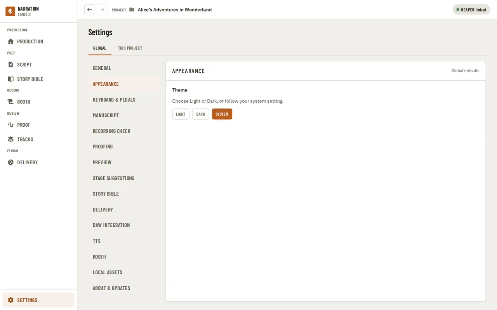
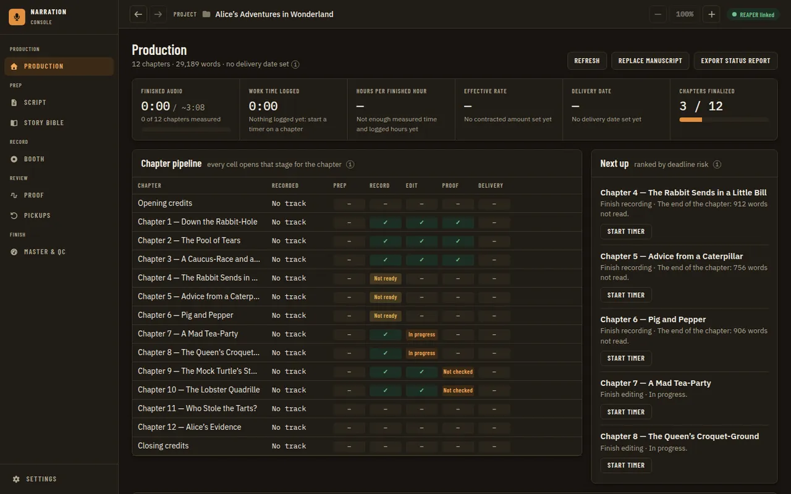
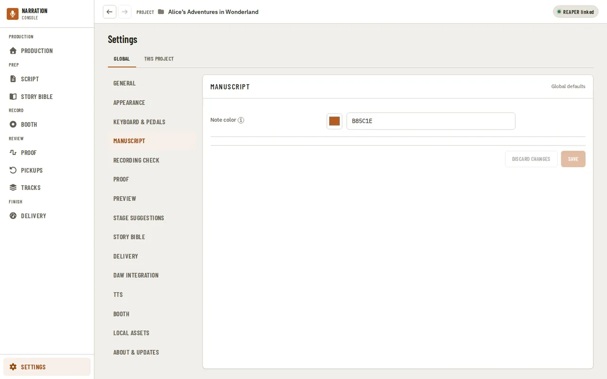
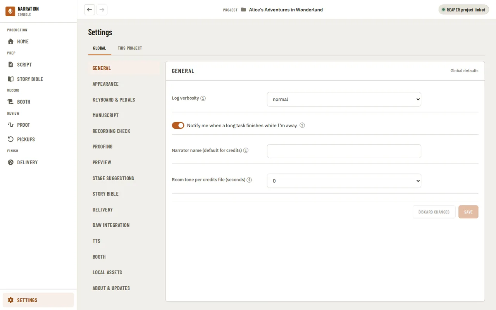
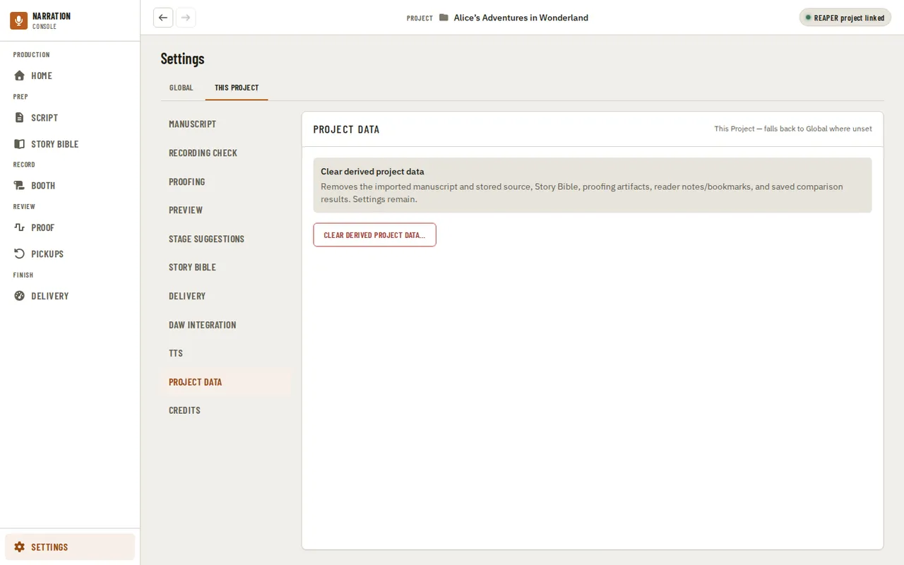
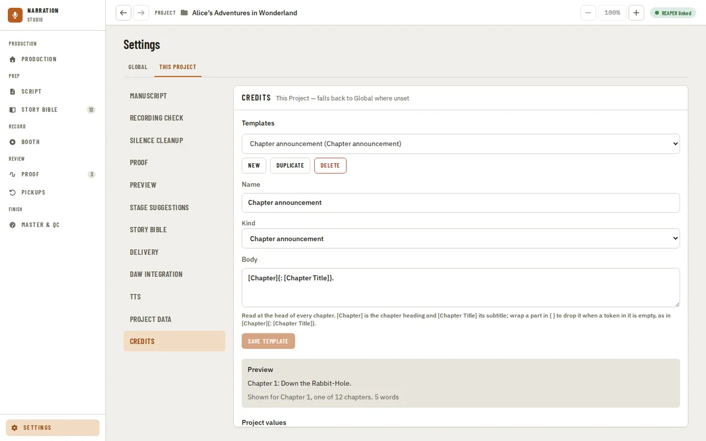
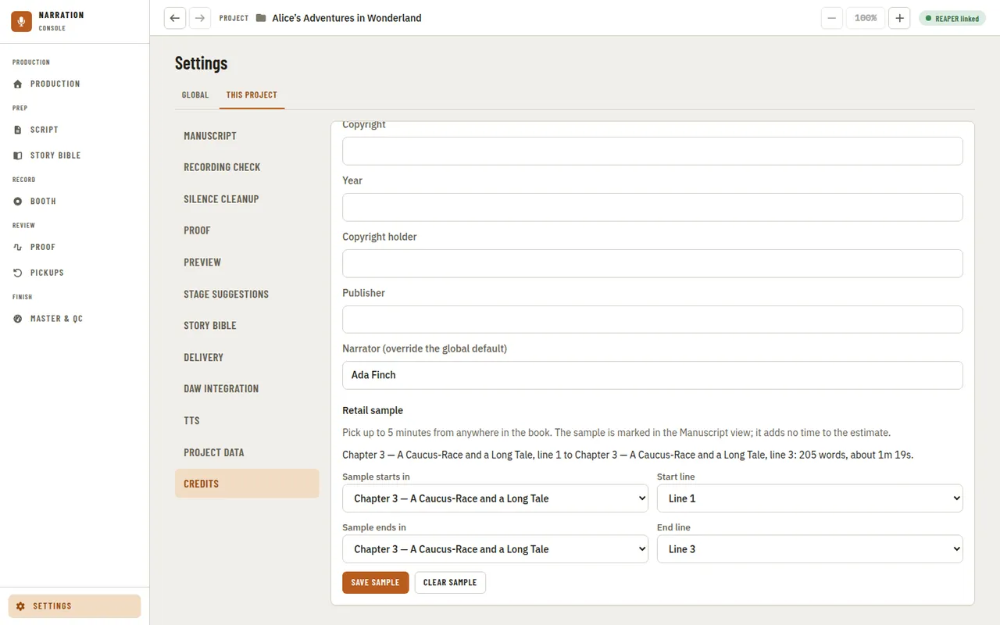
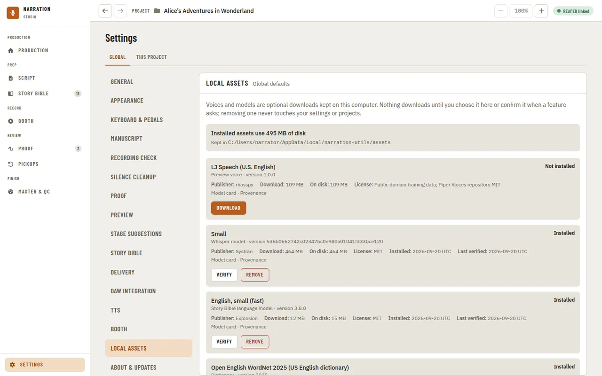
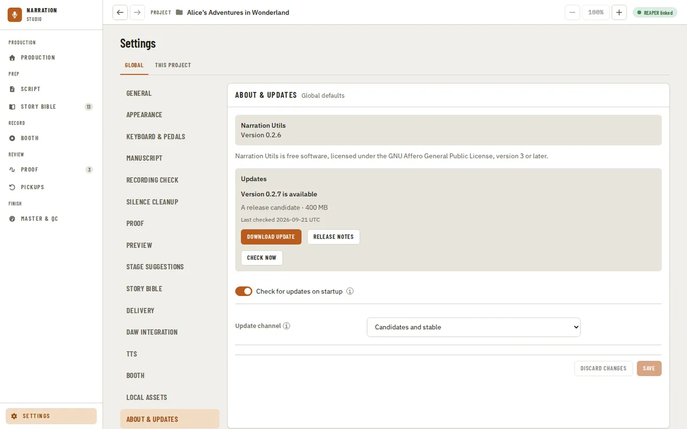

[Using the app](README.md) › Settings

# Settings

Settings is one page of panels, one under another: Recording, Delivery profile, the reader and Story Bible
panels and Appearance come first, then the panels for the rest of the settings.

- **Recording** chooses where this project's takes are recorded: **REAPER**, **Audacity** or the **Built-in
  recorder** (see [Choose REAPER](#choose-reaper)). The choice is saved with the project. A refused choice (no
  project open, a take running, or the built-in recorder not available) says why under the radios, and the
  choice stays where it was.
- **Delivery profile** picks the profile this project is judged against, on [Master &
  QC](master-and-qc.md) and [Delivery](delivery.md), the same choice as Delivery's own menu.
- **Definitions and pronunciations** chooses where the Script page's **Words** tab shows definitions from: the
  web page (the default), the local dictionary or the online service. The choice is saved for every project and is
  the same one as the Words tab's **Definitions from** menu. The local dictionary shows **Installed** or **Not
  installed** with a button to remove or download it; the online service shows **Online**, **Offline**, or **No key
  saved** until its key is saved.

- **Reader text** sets how the [Script](script.md) reader draws the text: **Font**, **Size**, **Line spacing** and
  **Column width**, over a quote drawn in them. These are the Script's own text settings, so a change here shows
  there and the other way round. The Booth keeps its own text size and uses the font chosen here. They are kept on
  this computer, not in the project.
- **Marks** lists your mark types, each with its colour, and **tracks a reply** on a type that asks for one.
  **Edit marks…** opens the same **Define how you mark up** dialog as the Script page.

- **Story Bible types** lists the kinds of [Story Bible](story-bible.md) entry, each with its name, colour, a
  **Can speak** box (entries of that type can be picked as the speaker of a quoted line, and the next Story Bible
  build attributes dialogue to them) and how many entries it has. A type you add with **New type** does not speak
  until you tick the box. Rename a type in its box and every entry of it moves with it; change its colour; or
  remove one: the remove button stays off while entries use the type, and the last type cannot go. A taken or
  reserved name is refused. A refused change says why under the list. The Story Bible's list and kind chips, its
  kind menu and the Script's speaker choices follow the list at once.
- **Story Bible analysis** lists the optional tools that make the Story Bible scan better (GLiNER, BookNLP small
  and large, and a local language model), each with what it does, its size, where it downloads from and the
  memory it needs, and the **Offer better analysis when scanning** box. A tool the app does not offer yet says
  **Not available yet** with the reason, and has no **Download**. None is offered in this version. Once one is,
  **Download** asks first, then shows progress, and **Remove** deletes it.

- **Appearance** sets the theme: **Match my system**, **Light** or **Dark**. The **Dark theme** / **Light
  theme** item at the foot of the sidebar switches it too.

- **Keyboard shortcuts** lists the keys, read-only; the **Keyboard & pedals** panel below changes them.
- **Manuscript** says when the manuscript was imported and how many words it has (or **No manuscript yet**),
  with **Replace manuscript…** (or **Import manuscript** when there is none). The replace confirm names what it
  clears.

Below them come General, Keyboard & pedals, Note colour, Recording check, Silence cleanup, Proof, Preview
suggestion, Stage suggestions, Story Bible, Delivery profiles, DAW Integration, TTS, Booth, Local assets,
Project data, Credits and About & updates. A panel whose settings can differ per project has a **Global** /
**This project** switch in its header: Global holds the defaults for every project, and This project the
overrides for the current one (a setting left unset there uses the Global value). Once you change a setting,
the panel shows **Unsaved changes** with **Save** and **Discard changes**. Switching its scope, or leaving
Settings, with unsaved changes asks whether to save or discard them.

- **General** (Global only) holds **Log verbosity** (`quiet`, `normal` or `verbose`); **Notify me when a long task
  finishes while I'm away** (on by default), a Windows notification when a long job ends while the app is
  not in front; the **Narrator name (default for credits)**; the **Room tone per credits file (seconds)**, 0
  to 10 and 0 by default: the silence the [Production](production.md#the-credits) credits estimate adds to
  the opening and to the closing credits file, head and tail together (ACX asks for 1 to 5 seconds at each
  end of every file); and **Debug logging (writes decision records to the run log)**.
- **Keyboard & pedals** (Global only) lists every command you can run without the mouse, grouped by where
  it works. **Change** opens a recorder under the command: press the key or pedal (a USB footswitch that
  types a key works like a keyboard), then **Replace**, **Add as another key**, **Unbind** or **Reset to
  default**. A key another command already uses is named, and **Replace** takes it from that command. A
  changed command shows **Changed** and its own **Reset**; **Reset all to defaults** undoes every change.
  Each change saves at once.
- **Note colour** holds the **Note color**, the colour that marks reader notes in the text.
- **Recording check** holds the four numbers the [recording check](production.md#checking-a-chapters-recording) uses: the **Share of
  each paragraph that must be read** (0.8) and the **Longest run of missing words allowed** (3)
  decide when a chapter counts as recorded, and the **Longest misread still counted as read** (8)
  and the **Shortest match that counts as read** (3) decide which words count as read at all. The
  panel states the rule they make and labels them **Proposed values, not yet calibrated**: they
  were chosen on synthetic test recordings and have not been checked against real recordings yet
  ([how they were chosen](../../utilities/recording-coverage.md#settings)). A skipped phrase of 3
  words or fewer can pass, because a transcriber drops single words too. Changing either of the first two only changes
  how a stored check is judged. Changing either of the last two makes earlier checks out of date, so
  those chapters need checking again. **Check changed chapters in the background** lets the app re-check a
  changed chapter by itself while your DAW is idle and not recording and the computer is on mains power.
  The panel also has its own switch, **Two-pass check (fast first pass, then re-check what's
  missing)**, off by default. On, a **First-pass Whisper model** and a **Re-check Whisper model**
  pick which model runs each pass ([how it works](../../utilities/recording-coverage.md#the-model-cascade)):
  a fast pass (`tiny` by default) transcribes the whole chapter, and a stronger one (`large-v3-turbo`
  by default) re-checks only what it reports missing, and **Also re-check passages Whisper is unsure of**
  (0.5) sends the stronger model the passages whose words Whisper scored under that share too, even when
  the text is all there (0 turns it off). Turning the two-pass check on does not change the model the
  **Proof** panel sets. Three more settings decide how a long chapter is transcribed
  ([long chapters](../../utilities/recording-coverage.md#long-chapters)): **Parallel Whisper processes**
  (0 lets the app choose from the model), **Chunk length in seconds** (300; 0 transcribes each recording
  whole) and **Crossover between neighbouring chunks** (6 s), and **Chapters checked at once** (1) says how many chapters **Check recordings** checks together, sharing the processors. They change how fast the check runs, not what
  it finds, so changing one does not make earlier checks out of date. **Check recordings** starts from these
  values and lets you change them for one run.
- **Silence cleanup** holds the thresholds the silence cleanup analysis uses when a
  [diagnostics](master-and-qc.md#diagnostics) check runs: the **Hold kept at each side of a cut silence**,
  the **Shortest run read as a breath** and **Longest run read as a breath**, **How far below speech level a
  breath sits**, and **How far above the silence around it a click stands**.
- **Proof** picks the **Default Whisper model** and **Default chunk length** for a comparison and the marker
  colors for misread, skipped and extra words. It shows whether the chosen model is installed, with
  **Remove local model…** once it is.
- **Preview suggestion** sets what the [Preview panel](proof.md#comparing-the-recording-with-the-script) suggests:
  the **Target length (seconds)**, the **Tolerance (fraction of target)**, the **Preset** (**Sample**, a clean,
  varied excerpt to share, or **Spot check**, a passage worth a second look) and **Exclude the ending
  (fraction of chapters)**, so a candidate never comes from the book's last chapters.
- **Stage suggestions** decides when Production suggests moving a chapter on ([stage
  readiness](production.md#stage-readiness)). **Suggest stage advances** turns every suggestion off at once;
  below it, each check (text present in order, empty space, clicks, breaths, pickups, and the rendered
  file's delivery checks) is `required` or `ignored`. The click and breath checks are marked **not yet
  validated**: requiring one means the stage is never suggested.
- **Story Bible** picks the spaCy model, whether to **Build the Story Bible after import**, and the
  **Default pronunciation source** a fresh pronunciation tries first (Automatic, CMU, Wiktionary or
  eSpeak) at build time and when you add an alias; it never limits generating or replacing a
  pronunciation by hand for a specific entry, which always lets you pick. In Global it also holds the
  **Online dictionary (Merriam-Webster)**: an optional free key of your own (**Get a free key**, **Save
  key**, **Remove key**) that Look up online uses when no dictionary on this computer knows a name; only the
  word you look up is sent. The analysis tools are the **Story Bible analysis** panel at the top of the page.
- **Delivery profiles** (Global only) picks the **Default delivery profile** for every project that has not chosen one (ACX
  until you change it); a project's own choice is the **Delivery profile** panel at the top of the page. A
  choice takes effect at once. The **Profiles** list shows the built-in ACX profile, read-only, and your custom profiles with
  what each is based on, how many numbers you changed and how many rules are off. **Duplicate** makes a
  custom copy and opens it in the editor, where you can rename it, turn a rule off, and change the
  lowest and highest of a rule that has a range (a length is in minutes); a rule with a fixed value can
  only be turned off, and a copy cannot add a kind of rule the app does not check. **Edit** and
  **Delete** work on a custom profile; a project that chose a deleted profile goes back to the Global
  default.
- **TTS** picks the provider and the preview voice used to [hear a name](story-bible.md#hearing-a-name),
  with **Remove local voice…** once the voice is installed.

Choosing a model or a voice here never downloads it; the app asks when a feature first needs it.

The **Booth** panel (Global only — the microphone, engine and model are machine facts, not a
per-project preference) remembers the microphone, live engine and model you last chose in the
[Booth](booth.md), and changing them here changes what the Booth starts with. The engine is Whisper
(the default) or Moonshine; the model is `tiny` or `small` for either. Choosing an engine or model whose
files are not on this computer asks for the download straight away, with its size and where it comes from;
closing the question without downloading puts your previous choice back. Record in the Booth also checks the
model first, so nothing records while it is being asked for. **Punch pre-roll (seconds)** is how far
before the word a punch-in starts. Old links to it by its former name, Teleprompter, still open it.

The **Project data** panel is a project-only danger zone: **Clear derived project data…**
removes the imported manuscript and its stored source, the Story Bible, proofing artifacts, reader notes and
bookmarks, and saved comparison results for the current project, after you confirm. Its settings remain.

## Choose REAPER

Each radio says whether that program was found on this computer, or what stops it (for example
**Experimental: switched off in Settings.**, with a link to [DAW Integration](#daw-integration), where the switch
is). A project folder holding a REAPER project file (`.rpp`) starts on REAPER; pick another radio to change it.

## Link your REAPER project

Under the radios is the project's REAPER file. With one `.rpp` in the project folder it reads **REAPER not
linked** and offers **Link** with the file's name; **Choose a project file** opens a file dialog for any other
`.rpp`.

The file can be in the project folder, in a subfolder of it, or anywhere else, such as a folder or drive you keep
for REAPER. A file inside the project folder keeps working when you move the whole project. For a file elsewhere,
a note says where the file and the project are. Only a file that is not an `.rpp`, or no longer exists, is
refused. Linking also chooses REAPER. Once linked, the panel reads **REAPER linked** with the file's name and
**Start REAPER**.

## DAW Integration

In **Global**, **DAW Integration** starts with **Digital audio workstation**: the DAW the app
works with (REAPER) and whether it is installed on this computer. When it is not, **Get REAPER** opens its
download page in your browser; the app never downloads or installs it for you. When it is installed and no
project is linked, **Link a REAPER project file** links one. **Check again** looks again.

Below that, the panel says whether your DAW is reachable: a running DAW has been heard from in the last 5 seconds,
and its open project does or does not match the linked one. **Launch REAPER** starts REAPER on the linked
project and needs a linked `.rpp` first.

The settings under it:

- **REAPER executable (override)**, for a REAPER the app does not find by itself.
- **Start the launcher script automatically** (off by default): REAPER runs the Narration Utils launcher
  when the app starts it.
- **Experimental REAPER actions** (off by default): the DAW actions not yet verified in REAPER stay
  refused while it is off, unless you set that action's own row below to `on`; while it is on, every one left on
  `auto` is allowed. Its **i** says the same.
- **Favourite effects (FX chains and plug-ins)**: the effects [Editing](editing.md#effects-on-words)
  offers first.
- One row per DAW action (`auto`, `on` or `off`), such as **Record**, **Punch and roll** or **Chapter
  regions**.

**What the DAW can do** lists each action with its level (**Supported**, **Experimental**, **Not yet
available** or **Unsupported**), the DAW's own reason when it is unavailable, how a change is made, and a
warning on any action that replaces audio that cannot be brought back. A **Backups** section follows only
for a DAW that keeps backups of the audio around an edit: how much audio either side is kept and for how
many days. Where the app knows the launcher's path, **REAPER launcher** shows it with **Copy path**, to
load once in REAPER as an action (**Actions > Show action list > New action > Load ReaScript**) and load again after each
update, since the path changes. The Booth shows the same steps when Record is waiting for REAPER ([Booth](booth.md#recording)).

In **This project**, the same panel shows whether a REAPER project is linked, with **Link a REAPER
project file** or **Change linked project file**: the same link as the pill in the
[header](navigation.md).

## Credits

**Credits** (this project only) holds the audiobook's opening and closing credits, an optional chapter
announcement, and the retail sample.

- **Templates**: pick a template to edit its **Name**, **Kind** (Opening, Closing or Chapter announcement)
  and **Body**, then **Save template**. **New** starts a blank one, **Duplicate** copies the selected one
  and **Delete** removes it.
- **Tokens**: bracketed tokens in the body, such as `[Title]`, `[Author]` and `[Narrator]`, are filled
  from the project values. Wrap a part in braces to drop it, punctuation and all, when a token in it has no
  value: `[Title]{: [Subtitle]}` reads just the title for a book with no subtitle.
- **Chapter announcement**: what you read at the head of every chapter. `[Chapter]` is the chapter's
  heading as the manuscript names it ("Chapter 1") and `[Chapter Title]` its subtitle ("Down the
  Rabbit-Hole"), so `[Chapter]{: [Chapter Title]}.` reads "Chapter 1: Down the Rabbit-Hole." and just
  "Prologue." for a chapter with no subtitle. You record it inside each chapter file, so keep it to the chapter
  heading and subtitle: Proof expects the spoken chapter title there, and any other words are reported
  as extra.
- **Preview** shows the body with the values filled in, its word count, and any token that has no value
  yet, highlighted and listed as unresolved. A chapter announcement is previewed for the first chapter
  ("Shown for Chapter 1, one of 12 chapters"); it needs an imported manuscript.
- **Project values**: Title, Subtitle, Author, Series, Book number, Copyright, Year, Copyright holder,
  Publisher, and a Narrator that overrides the global default from General for this project only. A value
  is saved as you type. Where the manuscript suggests a title or author, **Use suggestion** fills it in.
- **Clear credits** empties every project value at once, after asking. The templates in your library stay,
  so the credits show their tokens in brackets again until you fill them in.

The first opening and closing templates appear in the [Script](script.md) reader and as the
credits rows on [Production](production.md#the-credits).

### Retail sample

**Retail sample** is the stretch of the book you pick for the retailer's sample: up to 5 minutes, from
anywhere in the book. Choose the chapter and line it **starts in** and **ends in** (the line numbers the
[Script](script.md) reader shows) and **Save sample**. The panel says where it runs and how long it
is at about 155 words a minute; a range longer than 5 minutes is refused with its length, and the sample
you had is kept. **Clear sample** removes it. The sample is a marker in the Script page's reader only: it adds
no time to the estimate, since it is read again from the finished chapter. It is kept with the project, so
replacing the manuscript keeps it; if its lines are gone, the panel says so and you pick it again.

## Local assets

The **Local assets** panel lists every optional download Narration Studio can keep on this computer: preview
voices, Whisper models for proofing comparisons, the language model the Story Bible uses, the dictionary the Script reader's
Look up reads and the [Story Bible analysis](#settings) tools. Nothing here downloads by itself, and
removing one never touches your settings or projects. The page also shows how much disk the installed ones use and the folder they
are kept in.

Each entry says what it is, its exact version, who publishes it, its download and disk sizes, and links to its license, model
card and provenance. Its state is one of:

- **Not installed**: **Download** starts the download. A bar shows the real bytes so far and **Cancel** stops it while bytes are
  arriving; the checks after the last byte cannot be cancelled. A download that is already running when you open the page
  (started by a Story Bible build, a preview or a comparison) is shown here too, and leaving the page does not stop it.
- **Downloading** and **Verifying**: the download itself, then the check of every file against its approved size and checksum.
- **Installed**: **Verify** reads every file again and checks it (it can take a few seconds for a large model, and the button shows it
  is working), and **Remove** deletes that one asset after you confirm. The confirm says how much space it frees and what will ask
  to download it again.
- **Needs repair**: some files are missing or no longer match the approved ones, so the app will not use the asset. **Repair**
  downloads it again and checks it; **Remove** deletes it instead.
- **Not available yet**: the app lists the asset but does not offer it in this version (the Story Bible analysis tools, until
  every file they download is checked). The entry says why and has no buttons.

If a download, a check or a removal fails, the reason is written in that entry, and the entry keeps its buttons so you can try
again.

## About and updates

The last panel, **About & updates**, shows which version of Narration Studio you are running and looks
after updates.

- **Check for updates on startup** (on by default): once a day, when the app starts, it asks GitHub which releases exist. That
  request sends nothing about you, your projects or your computer, and it never downloads anything by itself. Switch it off
  if you would rather look yourself with **Check now**. When that check finds a newer version, a message also pops up
  ("Version 0.2.7 is available. See Settings, About & updates.").
- **Update channel**: *Candidates and stable* (the default; every release so far is a release candidate) or *Stable only*.
- **Download update** asks first, then downloads the new version with a progress bar showing the megabytes received, and
  checks it against the release's checksum. You can cancel while it downloads; the checks and unpacking after it cannot be
  cancelled, and the dialog says so.
- **Install and restart** asks again, then closes Narration Studio and starts it again on the new version with the same
  project. It will not install while an import, a Story Bible build, a download, a comparison or a teleprompter session is
  running: finish or stop it and try again. If the new version does not start, the previous one comes back by itself.
- If Narration Studio is installed somewhere it is not allowed to change (for example under Program Files) it says so and
  offers **Show the downloaded file**, so you can replace the program yourself. It never asks for administrator rights.
- **Release notes** opens the release page in your browser.

Narration Studio runs on Windows only, for now, so updates are for Windows.
Releases are not yet signed, so Windows SmartScreen or your antivirus may ask about a new version the first time.

If Narration Studio will not start after an update and the program file is missing from its folder, rename
`narration-utils.exe.old` back to `narration-utils.exe`.

---

[← Delivery](delivery.md) · [Index](README.md)
